# DAA Assignment 2 - Data Structures

## 1. Introduction

In this assignment I implemented three data structures from scratch: DynamicArray, MyLinkedList and MinHeap.

DynamicArray and MinHeap store primitive int values inside arrays. MyLinkedList stores int values inside nodes.

The goal was to compare these structures using operation counters and execution time on different workloads.

The benchmark uses the same generated data with Random(42) and tests sizes 100, 1000, 10000 and 100000.

---

## 2. Complexity Analysis

| Structure | Operation | Best | Average | Worst | Auxiliary Space | Explanation |
|---|---|---|---|---|---|---|
| DynamicArray | add(x) | Θ(1) | Θ(1) amortized | Θ(n) | Θ(1), Θ(n) during resize | Normally inserts at the end. When full, all elements are copied to a new array. |
| DynamicArray | add(index,x) | Θ(1) | Θ(n) | Θ(n) | Θ(1) | Elements after the index must be shifted to the right. |
| DynamicArray | remove(index) | Θ(1) | Θ(n) | Θ(n) | Θ(1) | Elements after the removed value are shifted left. |
| DynamicArray | get(index) | Θ(1) | Θ(1) | Θ(1) | Θ(1) | Array elements can be accessed directly by index. |
| DynamicArray | contains(x) | Θ(1) | Θ(n) | Θ(n) | Θ(1) | The search stops early if the value is found, otherwise it scans the array. |
| MyLinkedList | add(x) | Θ(1) | Θ(1) | Θ(1) | Θ(1) | The list stores a tail reference, so a new node is appended directly. |
| MyLinkedList | add(index,x) | Θ(1) | Θ(n) | Θ(n) | Θ(1) | Adding at the head or tail is constant time, but other positions require traversal. |
| MyLinkedList | remove(index) | Θ(1) | Θ(n) | Θ(n) | Θ(1) | Removing the first node is constant time, while other indexes require traversal. |
| MyLinkedList | get(index) | Θ(1) | Θ(n) | Θ(n) | Θ(1) | The list must move through nodes until the requested index is reached. |
| MyLinkedList | contains(x) | Θ(1) | Θ(n) | Θ(n) | Θ(1) | The value may be found immediately or after scanning the whole list. |
| MinHeap | insert(x) | Θ(1) | Θ(log n) | Θ(log n) | Θ(1), Θ(n) during resize | The value is inserted at the end and may bubble up to the root. |
| MinHeap | peekMin() | Θ(1) | Θ(1) | Θ(1) | Θ(1) | The minimum value is always stored at index 0. |
| MinHeap | extractMin() | Θ(1) | Θ(log n) | Θ(log n) | Θ(1) | The root is replaced by the last value and may bubble down through the heap. |

The total storage space of each structure is Θ(n).

---

## 3. Loop Invariant Proof 1 - DynamicArray contains(x)

### Invariant

Before every iteration of the loop, none of the elements in positions 0 through i - 1 is equal to x.

### Initialization

Before the first iteration, i is 0. No elements have been checked yet, so the invariant is true.

### Maintenance

During an iteration, the element at position i is compared with x.

If the values are equal, the method returns true.

If they are not equal, i is increased. Therefore all elements before the new value of i have been checked and are not equal to x.

The invariant is still true before the next iteration.

### Termination

The loop stops either when x is found or when i becomes equal to size.

If i equals size, every valid element of the array has been checked and none is equal to x.

Therefore the method correctly returns false.

### Conclusion

The invariant proves that contains(x) never skips an element. It returns true exactly when x exists in the DynamicArray.

---

## 4. Loop Invariant Proof 2 - MinHeap bubble-down in extractMin()

### Invariant

Before every iteration of the bubble-down loop, the heap property is valid everywhere except possibly between the node at the current index and its children.

### Initialization

After removing the minimum element, the last heap element is moved to index 0.

All other parent-child relationships remain unchanged.

Therefore only the new root may violate the heap property.

### Maintenance

During each iteration, the current node is compared with its left and right children.

If one child is smaller, the current element is swapped with the smallest child.

After the swap, the heap property is correct at the old position.

A violation can only remain at the new current position.

Therefore the invariant remains true.

### Termination

The loop terminates when the current node has no smaller child.

At that point the current node satisfies the heap property and every other part of the heap was already valid.

### Conclusion

The invariant proves that bubble-down restores the complete MinHeap property after extractMin().

---

## 5. Benchmark Results

The benchmark was executed for:

- n = 100
- n = 1000
- n = 10000
- n = 100000

Each case was executed five times. The first execution was treated as a JVM warm-up and was excluded from the final timing. The median of the remaining measurements was used.

The benchmark results are stored in:

`results/results.csv`

### W1 - Random Access

DynamicArray and MyLinkedList perform 10000 random get(index) operations.

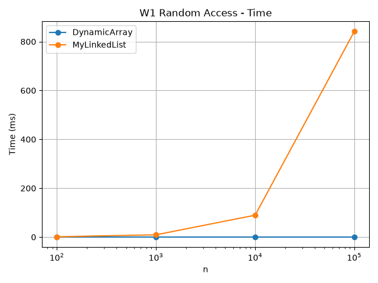

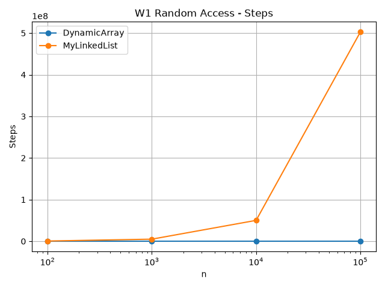

### W2 - Search

DynamicArray and MyLinkedList perform 1000 contains(x) operations. Half of the queries use present values and half use values that are not present.

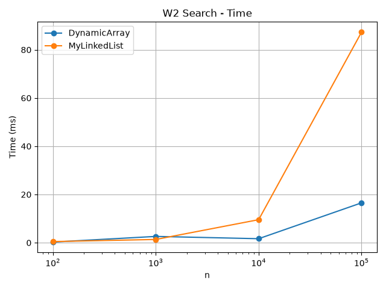

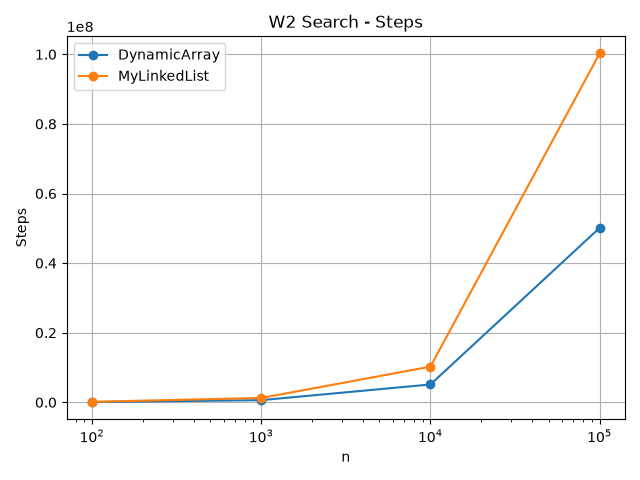

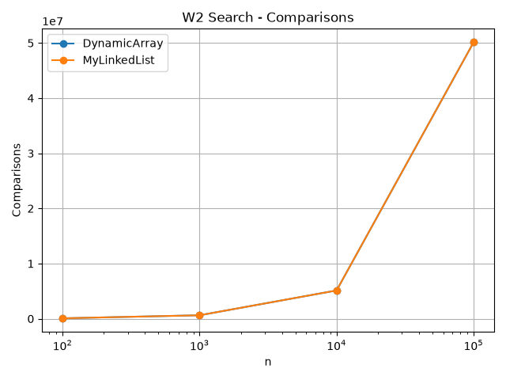

### W3 - Insert and Remove at Head

Each structure performs 1000 insertions and 1000 removals at index 0.

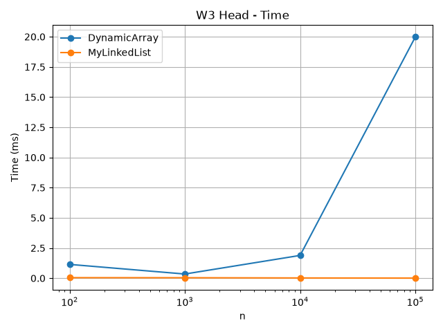

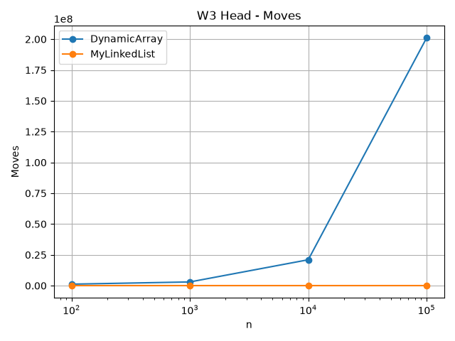

### W3 - Insert and Remove at Middle

Each structure performs 1000 insertions and 1000 removals around index n / 2.

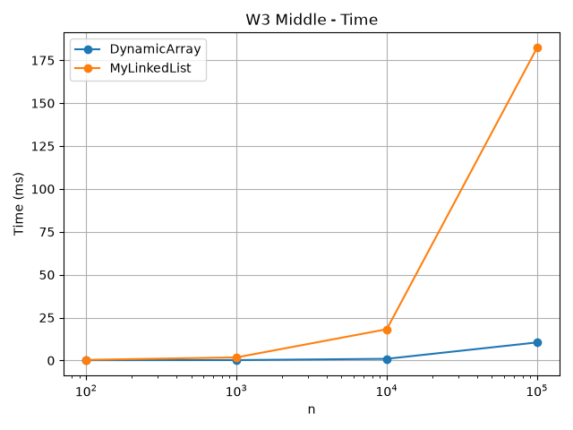

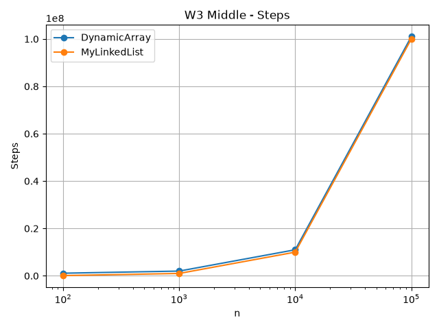

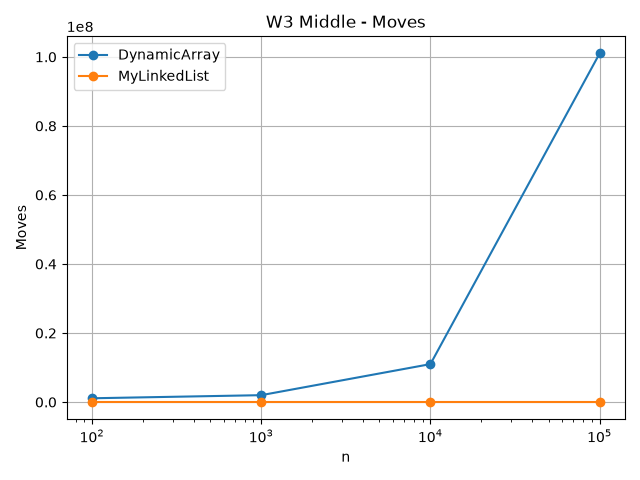

### W4 - Priority Processing

The MinHeap inserts n values and then extracts all values.

The extracted values are checked to make sure they are in non-decreasing order.

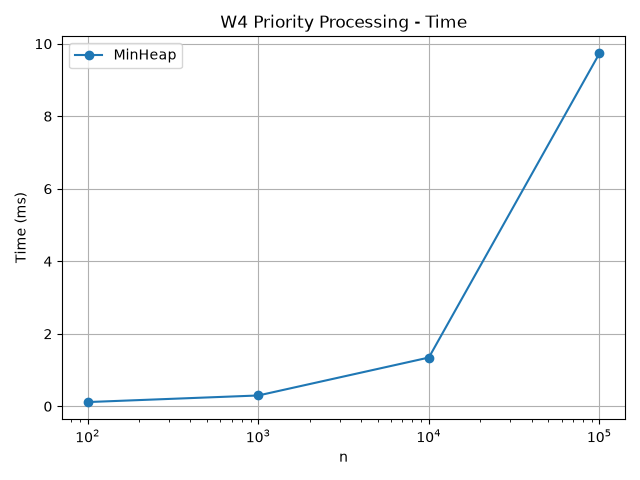

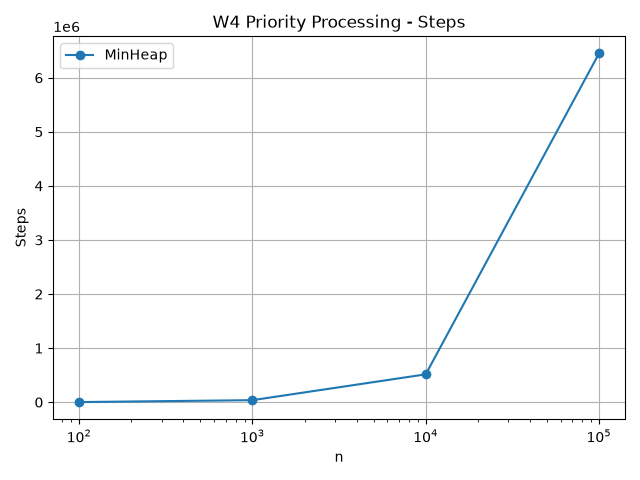

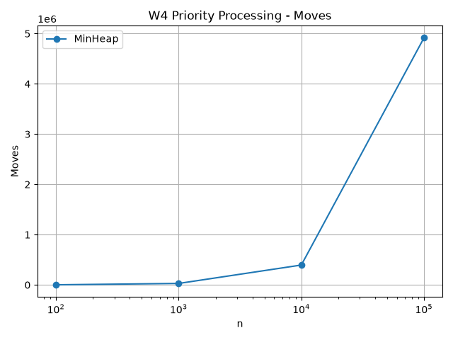

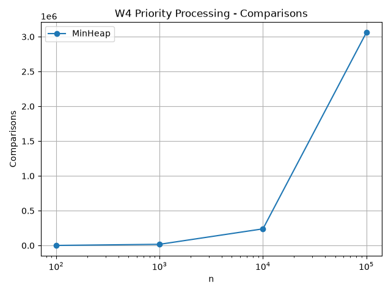

---

## 6. Discussion

DynamicArray is much faster for random access because it can calculate the location of an element directly from its index. MyLinkedList must follow node references one by one before it reaches the requested index. DynamicArray also benefits from spatial locality because its int values are stored next to each other in memory. This allows the CPU to load several nearby values into cache at the same time. Linked-list nodes can be located in different parts of memory, so pointer chasing causes more cache misses. A linked list can therefore be slower even when two algorithms appear to have similar Big-O complexity. Node objects also require additional memory for references and object information. DynamicArray performs poorly when many values are inserted or removed at the head because many elements must be shifted. MyLinkedList is better for operations at the head because only a small number of links need to be changed. Operations in the middle of a linked list are still expensive because the program first has to traverse to that position. MinHeap is useful when the smallest value must be processed repeatedly. Its peekMin operation is constant time and insertion and extraction are logarithmic. The benchmark demonstrates that asymptotic complexity is important, but memory layout and CPU cache behavior also strongly affect real execution time.

---

## 7. Conclusion

The experiment shows that there is no single best data structure for every workload.

DynamicArray is a good choice when fast index access and cache locality are important.

MyLinkedList is useful when insertions and removals near the beginning are frequent.

MinHeap is the best choice of these structures for priority-based processing where the minimum element must be retrieved repeatedly.